# 🛠️ GitHub 實用工具與AI應用目錄

本目錄彙整了專案目錄下 29 張圖片所提及的所有 **GitHub 好用工具、AI 應用及精選網站**。所有圖片皆已根據其主題重新命名，並在下方提供對應的詳細功能說明與圖片對照，方便您快速查閱與使用。

---

## 快速導覽目錄
1. [🤖 AI 輔助與 Agent 相關工具](#-ai-輔助與-agent-相關工具)
2. [💻 大語言模型與本地部署](#-大語言模型與本地部署)
3. [📄 文件與資料解析處理工具 (OCR / PDF)](#-文件與資料解析處理工具-ocr--pdf)
4. [⚡ 實用與效能優化工具](#-實用與效能優化工具)
5. [📈 金融與交易工具](#-金融與交易工具)
6. [🔄 工作流自動化](#-工作流自動化)

---

## 🤖 AI 輔助與 Agent 相關工具

### 1. Hermes AI Agent 系列
* **功能簡介**: 可以在本機端「做事」的 AI Agent 助理。它不僅能聊天，還能讀取專案檔案、修改程式碼、執行終端機指令（如跑測試、啟動服務），並透過安裝各式 Skills 來擴充功能（如 Freqtrade 量化研究 Skill）。
* **相關圖片**:
  * [Hermes 是什麼與目前用法 (hermes-what-is-agent.jpg)](hermes-what-is-agent.jpg)
  * [Windows + WSL 快速安裝入門 (hermes-install-guide.jpg)](hermes-install-guide.jpg)
  * [Hermes 新手推薦 8 個實用 Skills (hermes-skills-intro.jpg)](hermes-skills-intro.jpg)
  * [Front Design Skill 安裝教學 (hermes-front-design-skill.jpg)](hermes-front-design-skill.jpg)
* **圖片預覽**:
  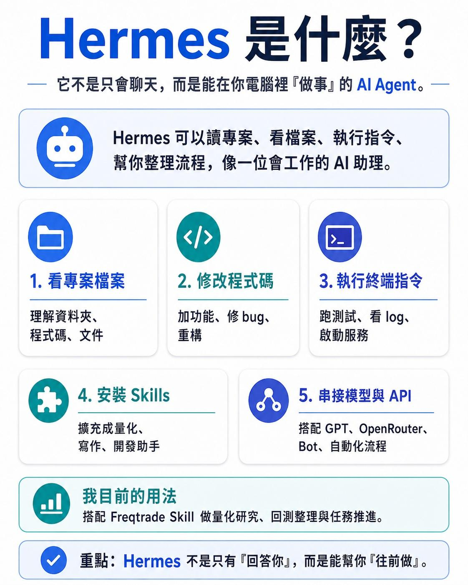

---

### 2. [Codebase Memory MCP](https://github.com/DeusData/codebase-memory-mcp) (7 大爆紅 Skill 之一)
* **功能簡介**: 能將整個 Codebase 程式庫轉換成 AI Agent 查得到的「3D 知識圖譜」。在 Claude Code、Cursor 或 Codex 中特別實用，能在大型專案中協助 AI 瞬間讀懂檔案關聯，實測可視覺化展示數百個檔案與數千個節點。
* **相關圖片**: [Codebase 3D 知識圖譜 (codebase-memory-mcp.png)](codebase-memory-mcp.png)
* **圖片預覽**:
  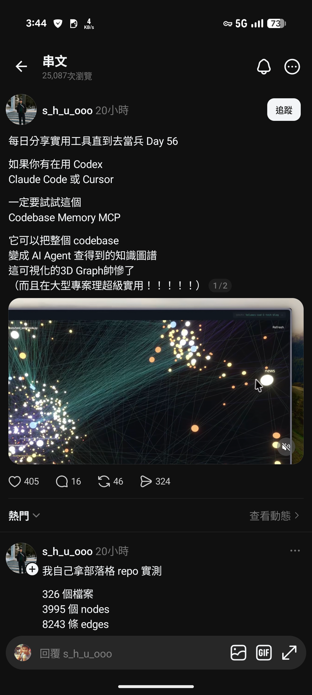

---

### 3. [Webwright](https://github.com/microsoft/Webwright)
* **開發團隊**: 微軟 (Microsoft)
* **功能簡介**: 擁有「終端機控制權」的瀏覽器自動化框架。不同於傳統 Playwright 無腦將網頁原始碼塞滿 Context Window，Webwright 會讓 Agent 在本機端產生並迭代一個可重複執行的 Python 腳本，透過無頭瀏覽器截圖自我驗證抓取資料的正確性。
* **相關圖片**: [Webwright 框架介紹 (webwright-browser-automation.png)](webwright-browser-automation.png)
* **圖片預覽**:
  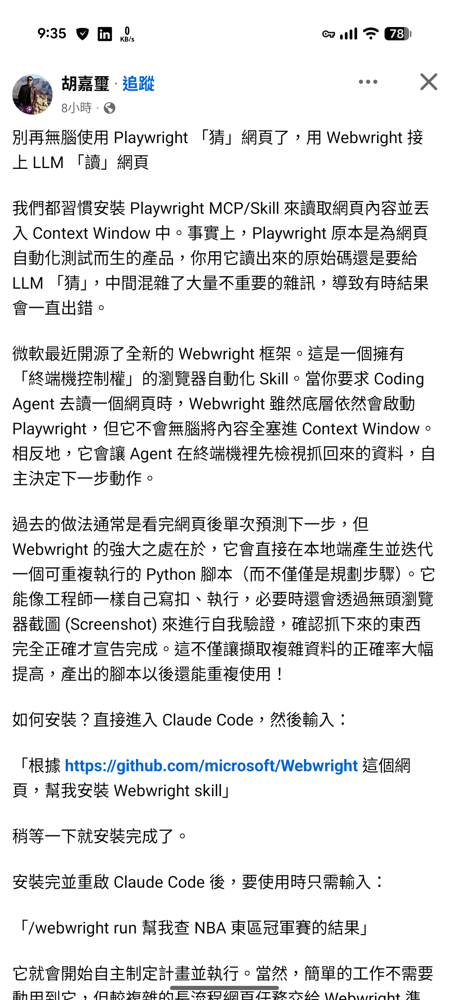

---

### 4. [linebot-multimodal-rag](https://github.com/evanlin/linebot-multimodal-rag)
* **作者**: Evan Lin
* **功能簡介**: 基於 Google Gemini API File Search 打造的 LINE Bot 多模態 RAG 知識庫。支援將文字、圖片、影片、音訊共享於同一個向量空間以實現「以圖找文 / 以文找圖」，並具備多租戶 Metadata 過濾與頁級引用（直接標註出自 PDF 第幾頁），僅需不到 600 行 Python 即可實作。
* **相關圖片**: [多模態 RAG LINE Bot (linebot-multimodal-rag.png)](linebot-multimodal-rag.png)
* **圖片預覽**:
  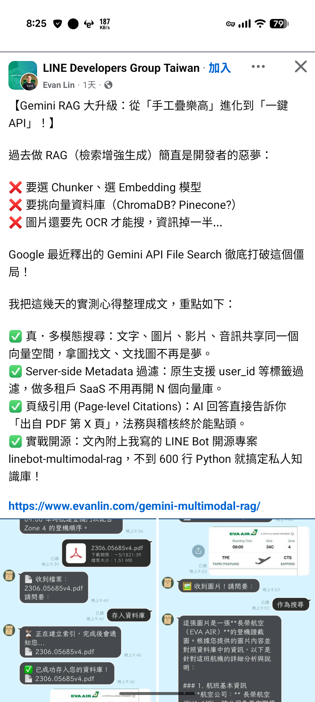

---

### 5. [rag-anything MCP](https://github.com/search?q=rag-anything)
* **功能簡介**: 企業知識庫 MCP 工具。使用者只需以自然語言提問，Agent 即可透過 MCP tools 從 PDF、LINE、Discord 等多元渠道的散亂文件中查詢解答並附上來源。支援多入口對話流回流追蹤。
* **相關圖片**: [rag-anything 知識庫應用 (rag-anything-mcp.png)](rag-anything-mcp.png)
* **圖片預覽**:
  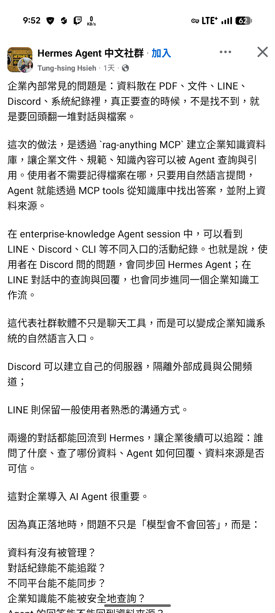

---

### 6. [Openhanako](https://github.com/search?q=Openhanako)
* **功能簡介**: 開源的「類龍蝦 (Claw/Cline)」AI 助手。原生支援 Windows 系統且設定簡單（填入 API Key 即可），支援多 Agent 能力，適合不想折騰 Linux 或虛擬機環境的開發者。
* **相關圖片**: [Openhanako 介面 (openhanako-agent.png)](openhanako-agent.png)
* **圖片預覽**:
  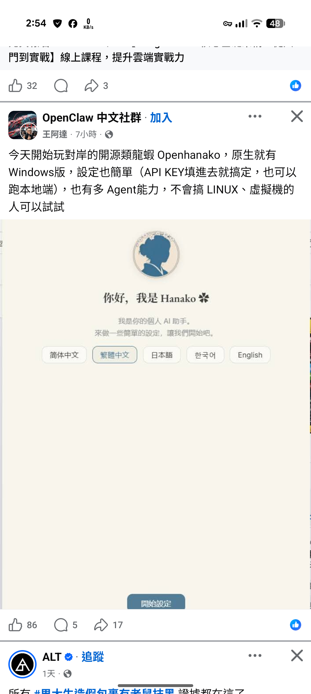

---

### 7. [Caveman](https://github.com/search?q=Caveman)
* **功能簡介**: 專門掛載於 Claude Code、Cursor 或 Gemini CLI 的「山頂洞人模式」Token 節省外掛。能自動省略所有主詞、冠詞與客套過渡句（例如：「好的，這就為您修改」），直接以最短的技術單字輸出，可暴力節省約 75% 的 API Token 並提升輸出速度。
* **相關圖片**: [Caveman 節省 Token 介紹 (caveman-token-saver.png)](caveman-token-saver.png)
* **圖片預覽**:
  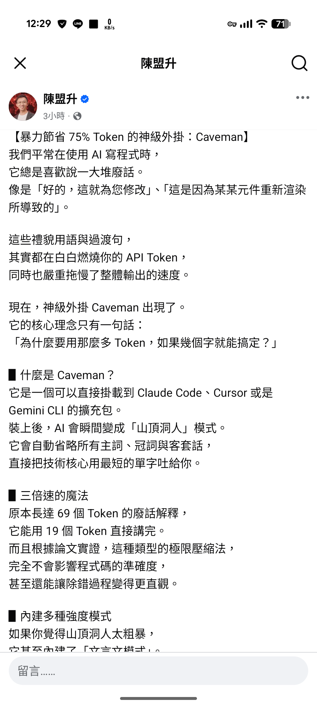

---

### 8. [agency-agents](https://github.com/msitarzewski/agency-agents)
* **作者**: msitarzewski
* **功能簡介**: 支援一鍵部署 147 個不同領域（包含設計、學術、工程、遊戲開發、行銷等）的 AI 員工 Agent 專案。
* **相關圖片**: [一鍵部署 AI 員工 (agency-agents.png)](agency-agents.png)
* **圖片預覽**:
  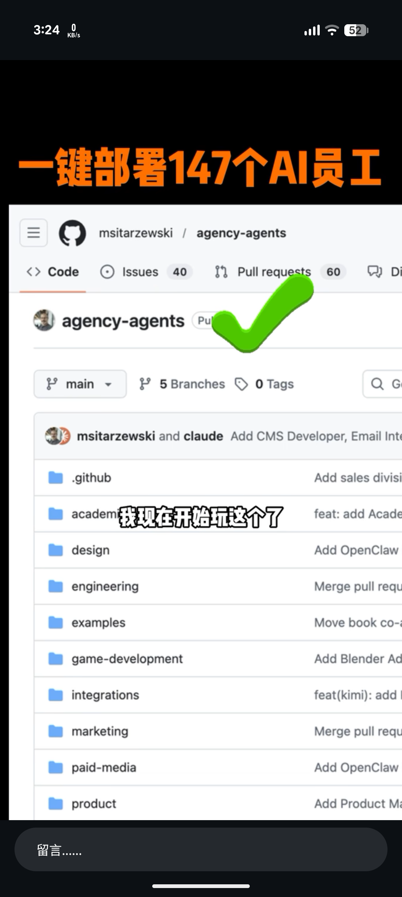

---

### 9. [Headroom](https://github.com/headroomlabs-ai/headroom) (7 大爆紅 Skill 之一)
* **功能簡介**: 本地運行的 AI Agent 上下文壓縮層。在資料傳給大模型前，會先過濾與壓縮工具輸出、系統日誌、檔案內容和 RAG 切片，壓縮率達 60%~95%。支援「可逆壓縮」(CCR)，當 AI 需要時能自動還原完整資料，避免 Context Token 暴漲的痛點。
* **與 Caveman 的差異**: Headroom 著重於**優化輸入端**（將讀取的 Context 裁剪精煉後再給 AI）；而 Caveman 著重於**優化輸出端**（讓 AI 回答時使用山頂洞人極簡模式省略客套話）。兩者結合能達到極致的 Token 節省。
* **相關圖片**: [7 大爆紅 Skill 整理 (agent-skills-7-collection.png)](agent-skills-7-collection.png)
* **圖片預覽**:
  

---

### 10. [Agent-Reach](https://github.com/Panniantong/Agent-Reach) (7 大爆紅 Skill 之一)
* **功能簡介**: 給 AI 代理配備上網的「眼睛」。作為網頁資料的路由器、安裝器與健康檢查器，讓 AI 代理能夠直接調用 `yt-dlp` 等 upstream 開源工具來瀏覽、搜尋和讀取包含 Twitter/X、Reddit、YouTube、GitHub、Bilibili、小紅書等 13+ 個社群平台，免去官方昂貴的 API 費用。
* **相關圖片**: [7 大爆紅 Skill 整理 (agent-skills-7-collection.png)](agent-skills-7-collection.png)
* **圖片預覽**:
  

---

### 11. [Agent Skills](https://github.com/addyosmani/agent-skills) (7 大爆紅 Skill 之一)
* **功能簡介**: 專門為 AI 程式碼編寫代理設計的生產級工程技能庫。透過將「專案規劃」、「測試撰寫」、「安全性稽核」等高級工程流程封裝成標準的 Agent Skills 格式，讓 AI 代理在遇到對應任務時能主動加載最佳實踐，產出更安全、更符合工程規範的程式碼。
* **相關圖片**: [7 大爆紅 Skill 整理 (agent-skills-7-collection.png)](agent-skills-7-collection.png)
* **圖片預覽**:
  

---

### 12. [SkillSpector](https://github.com/NVIDIA/SkillSpector) (7 大爆紅 Skill 之一)
* **開發團隊**: NVIDIA
* **功能簡介**: NVIDIA 開源的 AI 代理技能安全掃描器。為了避免部署惡意或含有安全漏洞的 AI Skills，SkillSpector 會在部署前進行靜態分析與 LLM 語意分析，檢測包括 Prompt 注入、敏感資料洩漏、特權提升和 MCP 工具 Poisoning 等 16 種類別共 64 種漏洞模式，並產出風險評估報告。
* **相關圖片**: [7 大爆紅 Skill 整理 (agent-skills-7-collection.png)](agent-skills-7-collection.png)
* **圖片預覽**:
  

---

### 13. [mattpocock/skills](https://github.com/mattpocock/skills) (AI Agent 技能庫)
* **功能簡介**: 由前 Vercel 工程師 Matthieu (Matt) 分享在 GitHub 上的 AI Agent 技能庫。內含多個能大幅提升開發與專案規劃效率的實用技能，特別適合在與 AI 協作時進行需求對齊與流程管理。本專案透過一個路由器指令進行串接與流程引導。
* **專案網址**: [mattpocock/skills](https://github.com/mattpocock/skills)
* **安裝指令**: `npx skills add mattpocock/skills` (安裝後可執行 `/setup-matt-pocock-skills` 初始化)
* **核心技能說明**:
  * **問答路由器 (Ask Matt - `/ask-matt`)**: 作為技能庫的路由中心，引導 AI 根據使用者的開發階段（從 Idea 到最終上線）呼叫適合的 Skill 流程。
  * **Grill Me (需求訪談技能 - `/grill-me`)**: 扮演「開工前的檢察官」角色。在專案初期反過來對使用者進行深度拷問與訪談（釐清開發動機、技術框架、限制等模糊細節），避免 AI 認真地「亂做」或猜測需求，拉高專案完整度與減少重構時間。
  * **Grill with Docs (文件對齊技能 - `/grill-with-docs`)**: 適用於既有開發專案。讓 AI 針對既有文件與使用者對齊所有的「文件定義、審核標準、錯誤管理」，並在專案中留下 `CONTEXT.md` 和設計決策記錄（ADRs）。
  * **to-spec & to-tickets (PRD 與任務拆解技能 - `/to-spec` / `/to-tickets`)**: 將前述訪談拷問出來的內容，直接轉換為產品需求文件（PRD / Spec）與可執行的任務票券（Tickets），並自動規劃 blocking dependencies。
  * **TDD (測試驅動開發技能 - `/tdd`)**: 在開發時執行，讓 AI 根據 spec 進行每個功能的測試（紅燈與綠燈案例測試），確保專案執行中最大程度降低 Bug 發生機率。
  * **Code Review (代碼雙軸審查技能 - `/code-review`)**: 針對標準規範（Standards）與功能規格（Spec）對程式碼進行雙軸審核，確保安全性與品質。
  * **知識蒸餾技能**: 透過網路上設定的最高標準（例如最頂尖的招募標準）拷問使用者，將特定人物的「判斷、知識、品味與決策」記錄轉化為可重複使用的 AI 技能。

---

## 💻 大語言模型與本地部署

### 1. [ds4 (Dwarf Star 4)](https://github.com/antirez/ds4)
* **作者**: Salvatore Sanfilippo (antirez, Redis 發明人)
* **功能簡介**: 讓配備 128GB/256GB 記憶體的個人電腦（如 Mac Studio M3 Ultra）能順暢跑起 DeepSeek V4 284b MoE 大模型的本地部署專案。支援 OpenAI 的 Endpoint 標準，於 DGX 上實測可達到 prefill 15 t/s 與輸出 14.8 t/s 的高速度。
* **相關圖片**: [ds4 專案介紹 (ds4-deepseek-runner.png)](ds4-deepseek-runner.png)
* **圖片預覽**:
  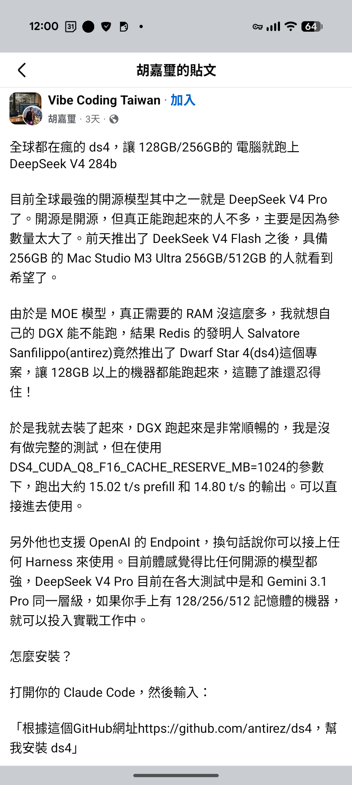

---

### 2. [Skywork.ai](https://skywork.ai/) (天工 AI)
* **功能簡介**: 整合了多模態模型與工具（如 Seedance 2.0、VM 版龍蝦與各大通訊軟體串接）的多合一 AI 平台，提供 24 小時在線的 Agent 助理服務，並提供每日免費點數額度。
* **相關圖片**: [天工 AI 平台截圖 (skywork-ai-platform.png)](skywork-ai-platform.png)
* **圖片預覽**:
  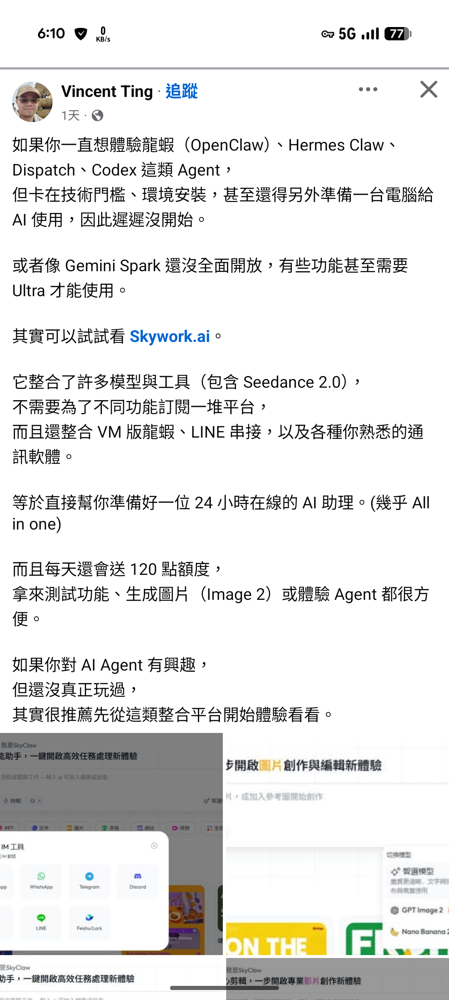

---

## 📄 文件與資料解析處理工具 (OCR / PDF)

### 1. [MarkItDown](https://github.com/microsoft/markitdown)
* **開發團隊**: 微軟 (Microsoft)
* **功能簡介**: 一鍵將各種文件格式（PDF、Word、Excel、PPT、HTML、圖片 OCR、音檔語音轉文字）轉換為 AI 看得懂且格式乾淨的 Markdown 格式，能保留標題、清單與表格結構，是建立 RAG 知識庫前進行資料清洗與整理的利器。
* **相關圖片**:
  * [MarkItDown 功能簡介 (markitdown-intro.png)](markitdown-intro.png)
  * [MarkItDown 專案主頁介紹 (microsoft-markitdown.png)](microsoft-markitdown.png)
* **圖片預覽**:
  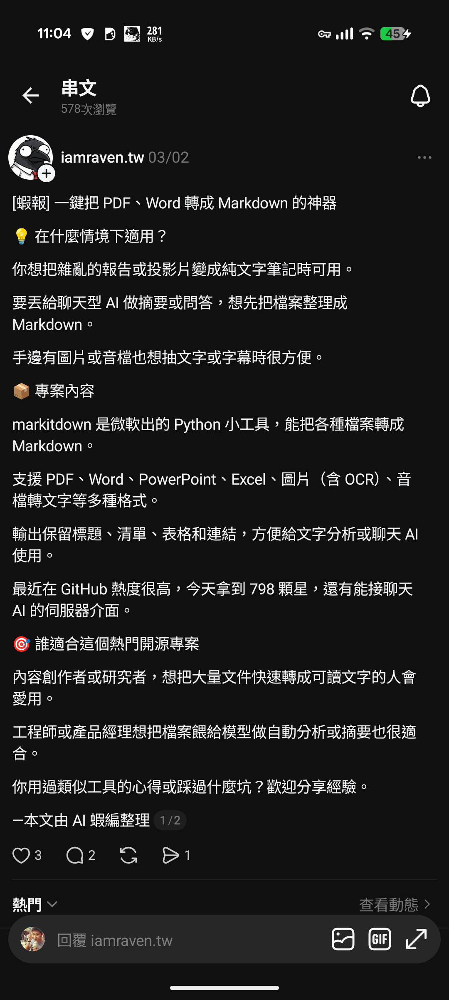

---

### 2. [Docling](https://github.com/DS4SD/docling)
* **開發團隊**: IBM
* **功能簡介**: 全地端支援 20+ 種檔案格式解析的開源神器。內建專屬的 **TableFormer** 模型，能完美辨識複雜的合併表格與雙排版排版，將其輸出為帶有標題層級與表格標籤的 Markdown 或 JSON，並原生支援 MCP 協議以供 AI Agent 使用，解決傳統解析工具在 RAG 應用中表格亂碼的痛點。
* **相關圖片**: [Docling 文件解析工具 (docling-rag-parser.png)](docling-rag-parser.png)
* **圖片預覽**:
  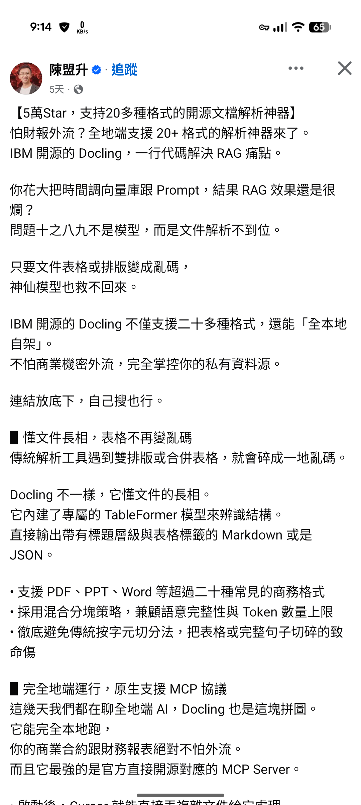

---

### 3. [Unlimited-OCR](https://github.com/baidu/Unlimited-OCR)
* **開發團隊**: 百度 (Baidu)
* **功能簡介**: 專門為極長 PDF 設計的文檔解析模型。引入了 **R-SWA 機制**（滑動窗口），讓快取大小維持在常數級，避免傳統視覺語言模型在處理長文件時顯卡記憶體（VRAM）暴增與解析變慢的問題，能以極速解析幾十頁的長文檔。
* **相關圖片**: [Unlimited-OCR 模型介紹 (baidu-unlimited-ocr.png)](baidu-unlimited-ocr.png)
* **圖片預覽**:
  

---

### 4. [PDFCraft](https://github.com/PDFCraftTool/pdfcraft)
* **功能簡介**: 主打「絕對隱私」、純前端 WebAssembly 技術運行的開源 PDF 工具箱。內建超過 90 種處理工具（如合併、分割、轉檔、加密、浮水印），所有運算都在使用者瀏覽器本機端完成，保證檔案不外傳。支援拖拽式視覺化工作流以進行批次自動化處理。
* **相關圖片**: [PDFCraft 工具箱介紹 (pdfcraft-wasm.png)](pdfcraft-wasm.png)
* **圖片預覽**:
  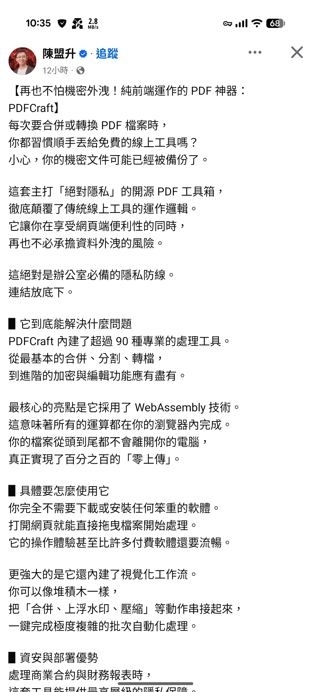

---

### 5. [jt-doc-tools](https://github.com/jasoncheng7115/jt-doc-tools)
* **作者**: Jason Cheng
* **功能簡介**: 辦公室文件工具箱。支援批次 PDF 解除密碼功能，並特別為台灣通勤族設計「高鐵模式」，拖入高鐵電子乘車證明 PDF 即可自動解密並重新命名為乘車日期，方便差旅報銷整理。
* **相關圖片**: [jt-doc-tools 介紹 (jt-doc-tools.png)](jt-doc-tools.png)
* **圖片預覽**:
  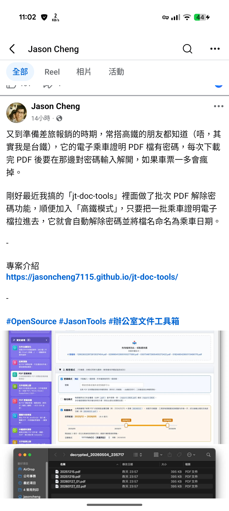

---

## ⚡ 實用與效能優化工具

### 1. [Winhance](https://github.com/memstechtips/Winhance)
* **功能簡介**: 基於 C# 開發的開源 Windows 11 系統增強優化工具。主打「系統精簡 (Debloat)」、「設定持久化」與「安裝 ISO 自訂」。能在不重新安裝系統且兼顧穩定性的前提下，一鍵安全地移除非必要的 Windows 預載軟體，且採用免安裝 (Portable) 設計。
* **相關圖片**: [Winhance 介面截圖 (winhance-windows-debloat.png)](winhance-windows-debloat.png)
* **圖片預覽**:
  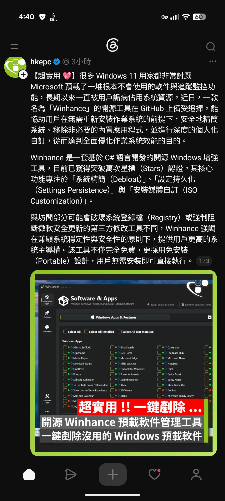

---

### 2. [Camofox](https://github.com/Camoufox/camoufox)
* **功能簡介**: 專為 AI 爬蟲與自動化設計的匿蹤瀏覽器。從 C++ 底層修改 Firefox，完美偽裝硬體特徵與渲染行為，能有效突破 Cloudflare 等防爬蟲封鎖機制。內建閒置休眠，僅占約 40MB 記憶體。可將網頁轉為縮減 90% 體積的無障礙快照，並自動為元素加上簡易精準標籤以利 AI 定位與點擊。
* **相關圖片**: [Camofox 匿蹤瀏覽器介紹 (camofox-browser.png)](camofox-browser.png)
* **圖片預覽**:
  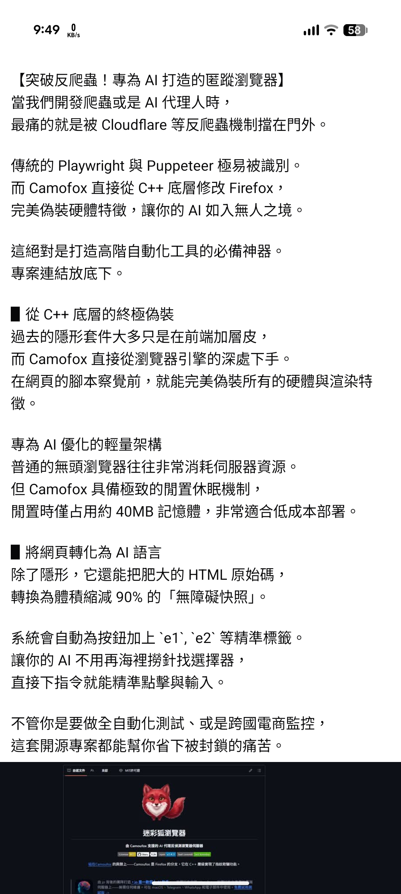

---

### 3. [remove-ai-watermarks](https://github.com/wiltodelta/remove-ai-watermarks)
* **功能簡介**: 去除 AI 隱藏浮水印與中介數據（如 C2PA 協議、Google SynthID 等）的工具，實測在拿掉 C2PA時能完全不損畫質，適合用來清理 AI 產圖的追蹤浮水印。
* **相關圖片**: [去除 AI 浮水印工具 GUI 介面 (remove-ai-watermarks.png)](remove-ai-watermarks.png)
* **圖片預覽**:
  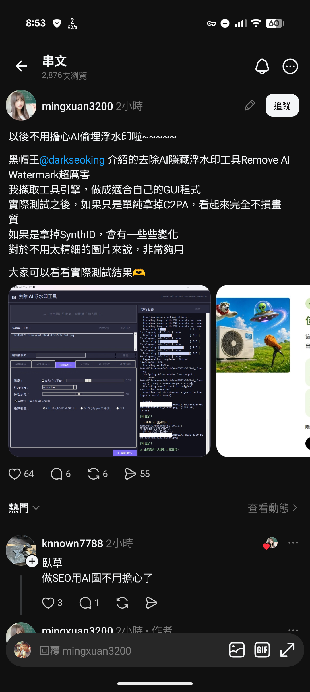

---

### 4. [Career-Ops](https://github.com/santifer/career-ops)
* **功能簡介**: 用 AI 反向篩選職缺的求職神器。能在本地掃描招聘平台並根據用戶自定義的 10 個維度對職缺進行 A-F 精準打分，篩選出高品質工作，並自動生成針對該 Job Description (JD) 優化的專屬 PDF 履歷以通過企業的 ATS 系統篩選。
* **相關圖片**: [Career-Ops 功能介紹 (career-ops-job-filter.png)](career-ops-job-filter.png)
* **圖片預覽**:
  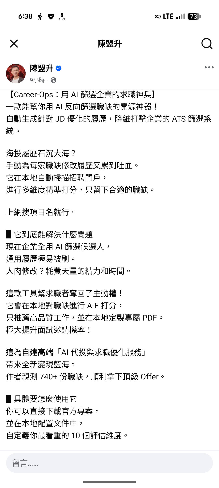

---

### 5. [jt-gelflow](https://github.com/jasoncheng7115/jt-gelflow)
* **作者**: Jason Cheng
* **功能簡介**: 網路流量即時監控視覺化工具。接收 Graylog 資料流，在前端以動態流量圖、2D地圖、3D地球以及最新版本加入的「桑基圖 (Sankey)」呈現，讓 IT 管理者能對公司的網路流量去向一目了然。
* **相關圖片**: [jt-gelflow 流量圖 (jt-gelflow.png)](jt-gelflow.png)
* **圖片預覽**:
  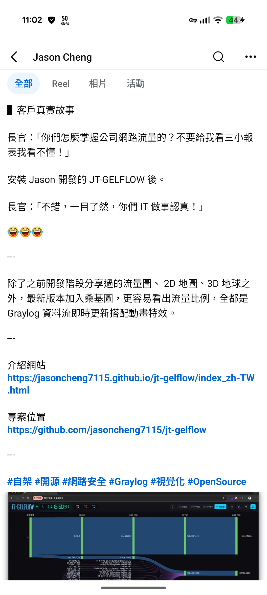

---

### 6. [IPTV](https://github.com/iptv-org/iptv) (7 大爆紅 Skill 之一)
* **功能簡介**: 全球免費網路電視頻道的超級懶人包。由社群驅動，收集世界各地公開免費播放的直播串流連結，並整理為標準的 M3U 播放清單，方便使用者直接匯入各種播放器中免費收看全球電視。
* **相關圖片**: [7 大爆紅 Skill 整理 (agent-skills-7-collection.png)](agent-skills-7-collection.png)
* **圖片預覽**:
  

---

## 📈 金融與交易工具

### 1. [Fincept Terminal](https://github.com/Fincept-Corporation/FinceptTerminal)
* **功能簡介**: 開源版的金融研究工作站（Bloomberg Terminal 替代方案）。整合了股票、總體經濟、新聞、加密貨幣等金融資料，並內建 AI Agent 來協助研究與摘要，專案使用 C++20、Qt6 與 Python 開發，在 GitHub 上已獲 23k+ 星標。
* **相關圖片**: [Fincept Terminal 介面 (fincept-terminal.png)](fincept-terminal.png)
* **圖片預覽**:
  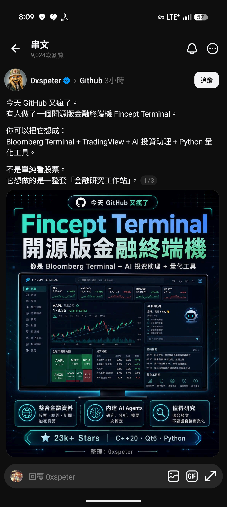

---

### 2. [Vibe-Trading](https://github.com/HKUDS/Vibe-Trading)
* **開發團隊**: HKUDS
* **功能簡介**: 個人交易 AI Agent 工作台。具備六大核心能力：自然語言交易研究、自動策略生成與回測、多格式程式碼輸出（TradingView Pine Script / MT5 等）、多 Agent 協作（研究、策略、風控）、交易紀錄行為模式診斷，以及能回放真實交易以量化交易紀律的 **Shadow Account** 影子帳戶功能。
* **相關圖片**: [Vibe-Trading 儀表板 (vibe-trading-agent.png)](vibe-trading-agent.png)
* **圖片預覽**:
  

---

## 🔄 工作流自動化

### 1. [n8n](https://github.com/n8n-io/n8n)
* **功能簡介**: 強大的節點式工作流自動化工具。學習歷程涵蓋 Trigger 觸發器、Gmail / Google Sheets 串接、RAG AI 機器人、MCP 協議結合以及將 n8n 作為輕量化網站後端等應用。在 Agent 時代，配合 n8n 跑固定流程是極具性價比（省 Token 與高穩定度）的自動化方案。
* **相關圖片**: [18 天 n8n 學習歷程 (n8n-learning-roadmap.png)](n8n-learning-roadmap.png)
* **圖片預覽**:
  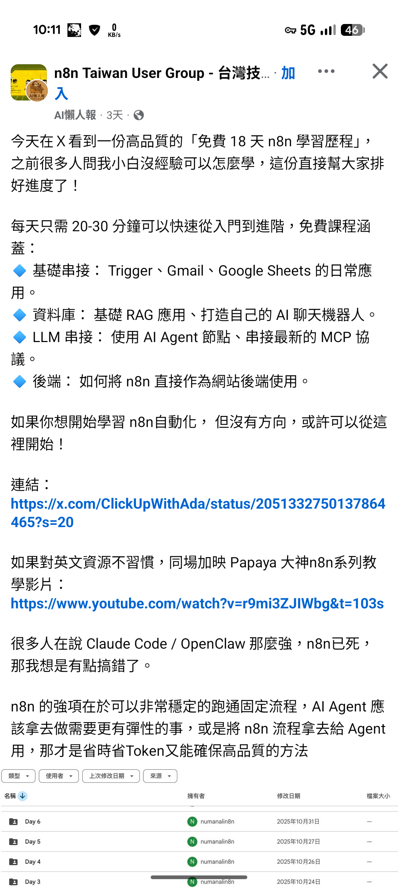
